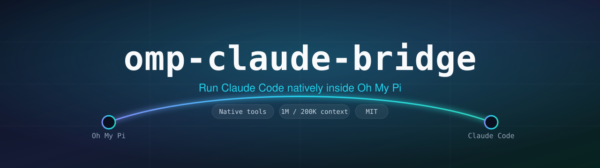

<div align="center">



<h1>omp-claude-bridge</h1>

<p><strong>Run Claude Code as a first-class model provider inside <a href="https://omp.sh">Oh My Pi</a> — with native tool bridging and a curated model catalog.</strong></p>

<p>
<a href="LICENSE"></a>


<a href="https://github.com/DevVig/omp-claude-bridge/actions/workflows/ci.yml"></a>

</p>

</div>

---

`omp-claude-bridge` lets you drive **Claude Code** — Opus, Sonnet, Haiku, and Fable — from inside Oh My Pi, with every tool call flowing through OMP's native TUI.

Authentication and billing run through Claude Code and your Anthropic subscription via the official [Claude Agent SDK](https://github.com/anthropics/claude-agent-sdk-typescript) — this extension never stores credentials.

<div align="center">
<a href="assets/claude-bridge1.png"></a>&nbsp;
<a href="assets/claude-bridge2.png"></a>
</div>

## Table of contents

- [Features](#features)
- [Install](#install)
- [Quickstart](#quickstart)
- [Models](#models)
- [Configuration reference](#configuration-reference)
- [How it works](#how-it-works)
- [Debugging](#debugging)
- [Development](#development)
- [Credits](#credits)
- [License](#license)

## Features

- **Claude Code as a provider** — pick Opus / Sonnet / Haiku / Fable from `/model`; tool calls render in OMP's TUI like any native provider.
- **Curated model catalog** — Claude 5.5, Opus 5, and retained earlier models with model-specific context windows.
- **Session resume & persistence** — conversations survive across turns and reconnects.
- **Skills + AGENTS.md forwarding** — your OMP skills and context files are passed into Claude Code's system prompt.
- **Thinking support** — effort levels map through to Claude Code, including `xhigh` on Sonnet models.
- **MCP tool bridging** with strict-config isolation by default.

## Install

```bash
omp plugin install git:github.com/DevVig/omp-claude-bridge
```

<details>
<summary>Other install methods</summary>

```bash
# From the full HTTPS URL
omp plugin install https://github.com/DevVig/omp-claude-bridge

# From a local checkout (great for hacking on it)
git clone https://github.com/DevVig/omp-claude-bridge.git
omp plugin install ./omp-claude-bridge
```

</details>

Requires Oh My Pi (`omp`) and a working Claude Code login.

## Quickstart

1. Install the plugin (above).
2. In OMP, run `/model` and choose a `claude-bridge/*` model — for example `claude-bridge/claude-sonnet-5-5`.
3. Work as usual. Tool calls run through OMP's TUI; Claude Code handles the model turn.

## Models

Pick any of these from `/model`. Each model has one picker entry; models requesting a 1M window have `1M` appended to their display name. The catalog is hardcoded in [`src/models.ts`](src/models.ts), rather than imported from a runtime model registry.

| Picker id | Requested window (default settings) | Claude Code model id |
| --------- | ------ | ------ |
| `claude-bridge/claude-fable-5` | 1M | `claude-fable-5[1m]` |
| `claude-bridge/claude-opus-5-5` | 1M | `claude-opus-5-5` |
| `claude-bridge/claude-opus-5` | 1M | `claude-opus-5[1m]` |
| `claude-bridge/claude-opus-4-8` | 1M | `claude-opus-4-8[1m]` |
| `claude-bridge/claude-opus-4-7` | 1M | `claude-opus-4-7` |
| `claude-bridge/claude-opus-4-6` | 200K¹ | `claude-opus-4-6`¹ |
| `claude-bridge/claude-sonnet-5-5` | 1M | `claude-sonnet-5-5` |
| `claude-bridge/claude-sonnet-5` | 1M | `claude-sonnet-5[1m]` |
| `claude-bridge/claude-sonnet-4-6` | 200K² | `claude-sonnet-4-6`² |
| `claude-bridge/claude-haiku-5-5` | 1M | `claude-haiku-5-5` |
| `claude-bridge/claude-haiku-4-5` | 200K | `claude-haiku-4-5` |

¹ Opus 4.6 requests `claude-opus-4-6[1m]` at 1M when `provider.plan` is `"max"` or `provider.longContextExtraUsage` is `true`.
² Sonnet 4.6 requests `claude-sonnet-4-6[1m]` at 1M when `provider.longContextExtraUsage` is `true`.

Registered context windows follow these runtime requests, so OMP's status bar and compaction threshold match the requested window. The underlying catalog records 1M for all models except Haiku 4.5 (200K); Opus 4.6 and Sonnet 4.6 are adjusted at registration according to the settings above. Subscription entitlement can still affect the window actually served.

The catalog also supplies the following cost metadata (input / output / cache read / cache write, in USD per million tokens). These are model metadata, not a separate charge by the extension; authentication and billing remain with Claude Code.

| Models | Input | Output | Cache read | Cache write |
| ------ | ----: | -----: | ---------: | ----------: |
| Fable 5 | 10 | 50 | 1 | 12.5 |
| Opus 5.5 | 4 | 20 | 0.2 | 5 |
| Opus 5, Opus 4.8, Opus 4.7, Opus 4.6 | 5 | 25 | 0.5 | 6.25 |
| Sonnet 5.5, Sonnet 5 | 2 | 10 | 0.2 | 2.5 |
| Sonnet 4.6 | 3 | 15 | 0.3 | 3.75 |
| Haiku 5.5 | 0.1 | 0.5 | 0.01 | 0.2 |
| Haiku 4.5 | 1 | 5 | 0.1 | 1.25 |

Bash commands issued by Claude Code get a 120-second default timeout (matching Claude Code's default), since OMP's bash has no timeout by default.

## Configuration reference

Config is read from `~/.omp/agent/claude-bridge.json` (global) and the project OMP config directory `.omp/claude-bridge.json` (project; merged over global). A starter file lives at [`claude-bridge.example.json`](claude-bridge.example.json).

```json
{
  "provider": {
    "plan": "pro",
    "longContextExtraUsage": false,
    "strictMcpConfig": true
  }
}
```

**`provider`**

| Key | Default | Description |
| --- | ------- | ----------- |
| `plan` | `"pro"` | `"pro"` or `"max"`; Max enables Opus 4.6's 1M runtime request. |
| `longContextExtraUsage` | `false` | Enable 1M runtime requests for Sonnet 4.6 and Opus 4.6. |
| `appendSystemPrompt` | `true` | Append OMP's AGENTS.md and skills. |
| `settingSources` | `["user", "project"]` when used | Claude Code filesystem settings to load (`"user"`, `"project"`, `"local"`); only applied when `appendSystemPrompt: false`. |
| `strictMcpConfig` | `true` | Block MCP servers from `~/.claude.json` / `.mcp.json`. Cloud MCP is always blocked. |
| `pathToClaudeCodeExecutable` | — | Path to the `claude` binary, if the bundled one can't run on your OS/filesystem. |

## How it works

OMP's built-in tools are bridged to Claude Code and back, so from your side it behaves like any other OMP provider. [`src/index.ts`](src/index.ts) loads configuration, installs session lifecycle hooks, and registers the provider. The implementation is split into focused modules:

- [`src/provider.ts`](src/provider.ts) — Claude Agent SDK queries and streaming provider flow.
- [`src/mcp-bridge.ts`](src/mcp-bridge.ts) and [`src/tool-mapping.ts`](src/tool-mapping.ts) — OMP tool exposure and argument mapping.
- [`src/runtime.ts`](src/runtime.ts) and [`src/session-store.ts`](src/session-store.ts) — shared runtime state and session persistence.
- [`src/stream-processing.ts`](src/stream-processing.ts) and [`src/prompt.ts`](src/prompt.ts) — stream handling and prompt construction.
- [`src/models.ts`](src/models.ts) — hardcoded model catalog, Claude Code runtime ids, and model-specific context policy.

The extension uses `@earendil-works/*` imports, which OMP rewrites at extension load time.

## Debugging

Set `CLAUDE_BRIDGE_DEBUG=1` for detailed logs:

- **Bridge log** — `~/.omp/agent/claude-bridge.log`: every provider call, session-sync decision, tool-result delivery, and Claude Code stderr. Override the path with `CLAUDE_BRIDGE_DEBUG_PATH`.
- **Per-query CLI logs** — `~/.omp/agent/cc-cli-logs/<timestamp>-<tag>-<seq>.log`: the Claude Code subprocess's own debug stream, one file per query. Tags are `provider` or `continuation`.

When filing a session-resume bug (e.g. "No conversation found"), the `syncResult:` lines from the bridge log plus the matching `cc-cli-logs/` file are the most useful attachments.

## Development

```bash
git clone https://github.com/DevVig/omp-claude-bridge.git
cd omp-claude-bridge
bun install

bun run typecheck   # tsc --noEmit
bun run test        # node --test unit suite
```

See [CONTRIBUTING.md](CONTRIBUTING.md) for the full workflow. CI runs typecheck and tests on every push and PR.

## Credits

- Original **[pi-claude-bridge](https://github.com/elidickinson/pi-claude-bridge)** by **[Eli Dickinson](https://github.com/elidickinson)** — the streaming provider, MCP/tool bridging, and session resume this project builds on.
- Initial inspiration from [claude-agent-sdk-pi](https://github.com/prateekmedia/claude-agent-sdk-pi) by Prateek Sunal.
- **Oh My Pi port and context-window controls** by **[Jonathan Borgwing](https://github.com/DevVig)**.

See [NOTICE](NOTICE) for full attribution.

> Anthropic [announced and then unannounced](https://support.claude.com/en/articles/15036540-use-the-claude-agent-sdk-with-your-claude-plan) a change to how Agent-SDK tool usage is billed. As of June 15, 2026 it uses your subscription quota just like Claude Code direct.

## License

[MIT](LICENSE) © 2026 Eli Dickinson (original) and Jonathan Borgwing (Oh My Pi port and context-window controls).
